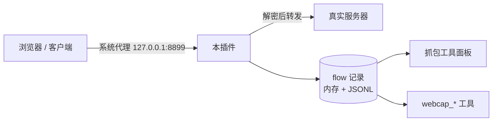

# Flowspot

**在 DSH 里抓 HTTPS：点一次「开始抓包」，Windows 上走系统代理的程序（浏览器、Electron 应用、桌面客户端）的请求都会被记录下来，面板能看，agent 也能直接读。**

`Windows` · `MITM 代理` · `零运行时依赖` · `9 个 webcap_* 工具`

[项目介绍](#项目介绍) · [项目功能](#项目功能) · [不支持或需要额外条件](#不支持或需要额外条件) · [快速开始](#快速开始) · [怎么工作](#怎么工作) · [安全与隐私](#安全与隐私) · [项目结构](#项目结构)

---

## 项目介绍

想看一个网页或客户端到底调了哪些接口，通常要开 DevTools 或者装 Charles。这个插件把这件事收进 DSH：安装一次证书、点一次「开始抓包」，之后所有认 Windows 系统代理的程序，请求都会出现在侧栏的「抓包工具」面板里。也可以让 agent 用 `webcap_*` 工具直接读这堆请求。

## 项目功能

- **HTTPS 抓包**：点一次「开始抓包」，本机代理接管 Windows 系统代理；浏览器、Electron 应用、桌面客户端的 HTTPS 请求都会被解密并记录，不需要专门启动某个浏览器。
- **证书管理**：面板「设置」里一键安装或卸载根证书；每个域名第一次出现时自动签发对应证书，不用预先配置域名白名单。
- **请求列表**：按 F12 分类（Fetch/XHR、文档、CSS、JS、图片、媒体、字体、WS、Wasm、清单、其他）筛，选中 Fetch/XHR 后可再按请求方法二级筛选；成功与失败分开显示，默认 8:2（可切 `Default / Success / Error`），失败项整行红色。
- **接口合并**：方法 + 完整 URL 相同的请求只占一行、行尾标 `×N`，点开按时间顺序看每一次——轮询接口不再刷屏，也不会把新接口挤出列表。
- **两种打开方式**：左侧栏「抓包工具」整页打开，或停靠到右侧栏边聊边看；面板右上角的 **⇄** 随时切换。
- **agent 读取**：9 个 `webcap_*` 工具——状态、启停、CA、列表、详情、报文体、搜索、导出、清空，agent 直接读抓到的请求，不需要你手抄日志。

## 不支持或需要额外条件

- **只支持 Windows**：系统代理与证书安装依赖 Windows 的注册表和证书存储。
- **只抓认系统代理的程序**：自己直连、不走系统代理的程序不在范围内。
- **手机流量**：插件不处理；另外安装 `proxypin-mcp/` 把 ProxyPin 的 MCP 接进来。
- **HTTP/2**：只记录 HTTP/1.1（浏览器会自动回落，页面照常）。
- **WebSocket**：只记录握手，不解析帧。
- **Firefox**：需要手动把数据目录里的 `ca.crt` 导入 Firefox 证书库。

## 快速开始

### Ⅰ 安装

插件（包名 `dsh-flowspot`）要装进 DSH 的 profile（下面以 `web` 为例），放在磁盘上不等于装好。

**Web 界面**：左侧栏 **插件 → 添加插件**，填本仓的绝对路径，安装后点 **立即启用**。

**命令行**：

```powershell
dsh plugin --profile web add "<本仓绝对路径>"
```

装完重启 DSH。**改过插件源码要重装一次再重启**——profile 里用的是安装副本；只刷新页面不更新宿主侧代码。

跑测试（纯 Node，不需要 DSH，也不需要先装插件）：

```powershell
node --test test/
```

### Ⅱ 开启抓包

1. 左侧栏点 **抓包工具**；
2. 面板右上角 **设置** → **安装 CA**（装进「当前用户 → 受信任的根」，不需要管理员）；
3. 点 **开始抓包**，系统代理会指向本机代理并立即生效；
4. 装完 CA 后重启一下浏览器。

想边聊边看：右侧栏 **+** →「抓包工具」，同一块面板会停靠到右栏；面板右上角 **⇄** 在整页与右栏之间切换。

等效的 agent 调用：

```text
webcap_ca    { "action": "install" }
webcap_serve { "action": "start" }
```

### Ⅲ 试一次

1. 浏览器打开 `https://example.com`，随便点几下；
2. 面板「请求列表」里点 `Fetch/XHR`，再点 `POST`，列表只剩接口请求；
3. 让 agent 依次调：

```text
webcap_flows  { "limit": 20 }              # 抓到了什么
webcap_detail { "id": "f3" }               # 头、状态、耗时、体大小
webcap_body   { "id": "f3", "side": "response" }
webcap_export { "format": "curl", "id": "f3" }
```

4. 抓完点「停止抓包」，系统代理恢复成开启前的值。

### Ⅳ 卸载

**先停止抓包再卸载**，否则系统代理会指向一个已经关掉的端口。

Web 界面：**插件** → `dsh-flowspot` → **卸载**。命令行：

```powershell
dsh plugin --profile web remove dsh-flowspot
```

卸载不会动这两样，需要自己收尾：

- **根证书**还在「受信任的根」里：卸载前点 **设置 → 卸载 CA**；已经卸了插件就 `certutil -delstore -user Root <SHA-1>`；
- **数据目录**不会自动删：默认 `%USERPROFILE%\.dsh\dsh-flowspot`，里面是 CA、私钥、`flows/` 抓包记录和系统代理备份。

最后重启 DSH。

## 怎么工作



- 代理默认监听 `127.0.0.1:8899`；端口被占用或被 Windows 保留时自动换一个，实际端口显示在面板状态里。
- 数据目录默认 `%USERPROFILE%\.dsh\dsh-flowspot`，放证书、抓包记录和系统代理备份。
- 敏感请求头默认打码；单个报文体最多保留 256 KiB。

要改端口、数据目录或这些上限，见 `docs/pipelines.md` 的「配置与数据目录」。

## 安全与隐私

- 代理只监听 `127.0.0.1`，但本机任何程序都能使用它；不要在有不受信任软件的机器上开着抓包。
- 抓到的请求会以明文写进数据目录的 `flows/*.jsonl`：`authorization`、`cookie` 等头默认打码，其余（含请求体和响应体）保持原样。数据目录不要上传、不要进版本库。
- 数据目录里的 `ca.key.pem` 是本机根证书私钥，泄露等于允许别人伪造任意 HTTPS 站点；只留在本机，卸载时一并删除。
- 面板路由会拒绝来自其他网站的请求，但本机进程仍可直接调用这些接口；抓完请停止抓包。

## 项目结构

```text
dsh-flowspot/
├── index.js             插件入口
├── cordis.patch.yml     bundle 描述：装进 profile 的一行
├── lib/                 代理、证书、请求存储、agent 工具、面板路由
├── client/client.js     抓包工具面板
├── proxypin-mcp/        配置型 bundle：接 ProxyPin 的 MCP（给手机用）
├── locale/              插件管理器里的标题与描述
├── test/                契约测试（node --test test/）
└── docs/                # 内部说明，日常使用不必读
```

仓库：https://github.com/moyezq/dsh-flowspot ｜ 许可证：MIT（见 `LICENSE`）。
