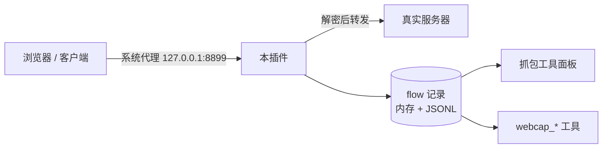

# Flowspot

**在 DSH 里抓 HTTPS：点一次「开始抓包」，Windows 上走系统代理的程序（浏览器、Electron 应用、桌面客户端）的请求都会被记录下来，面板能看，agent 也能直接读。**

`Windows` · `MITM 代理` · `零运行时依赖` · `14 个 webcap_* 工具`

[项目介绍](#项目介绍) · [项目功能](#项目功能) · [不支持或需要额外条件](#不支持或需要额外条件) · [快速开始](#快速开始) · [怎么工作](#怎么工作) · [安全与隐私](#安全与隐私) · [项目结构](#项目结构)

---

## 项目介绍

想看一个网页或客户端到底调了哪些接口，通常要开 DevTools 或者装 Charles。这个插件把这件事收进 DSH：安装一次证书、点一次「开始抓包」，之后所有认 Windows 系统代理的程序，请求都会出现在侧栏的「抓包工具」面板里。也可以让 agent 用 `webcap_*` 工具直接读这堆请求。

## 项目功能

- **HTTPS 抓包**：点一次「开始抓包」，本机代理接管 Windows 系统代理；浏览器、Electron 应用、桌面客户端的 HTTPS 请求都会被解密并记录，不需要专门启动某个浏览器。
- **证书管理**：面板「设置」里一键安装或卸载根证书；每个域名第一次出现时自动签发对应证书，不用预先配置域名白名单。
- **请求列表**：按 F12 分类（Fetch/XHR、文档、CSS、JS、图片、媒体、字体、WS、Wasm、清单、其他）筛，选中 Fetch/XHR 后可再按请求方法二级筛选；成功与失败分开显示，默认 8:2（可切 `Default / Success / Error`），失败项整行红色。
- **两个互斥抓包模式**：**系统抓包**走 Windows 系统代理，适合先全局找接口；**CDP 抓包**接管一个 Chrome 标签页，列表用同一套列/筛选/合并，详情多调用链（同步段 + 异步段全展开，可切「只看业务帧」）。切换模式会暂停另一边，两边数据各自保留、清空互不影响。
- **多语言脚本**：请求详情里切到「代码」，把一条 flow 生成 cURL / Python / Go / Rust / JavaScript / Node.js 脚本并一键复制；按钮的顺序与显隐在「设置 → 代码语言」里配，偏好存在本机。
- **CDP 调用链**：接管当前 Chrome 标签页（保留日常登录态），请求详情多一节调用链——F12 Initiator 同款的帧列表、业务方法名、点一帧看本机源码；CDP 抓到的接口同样能转脚本。
- **接口合并**：方法 + 完整 URL 相同的请求只占一行、行尾标 `×N`，点开按时间顺序看每一次——轮询接口不再刷屏，也不会把新接口挤出列表。
- **按次归档**：每次「开始抓包」单独写一份 `flows/*.jsonl`，重启后仍能按会话回溯；只加载插件、或开了抓包却没有流量，都不留空文件。
- **运行埋点**：只记非请求事件（端口兜底、系统代理、证书安装、数据目录切换、CDP 启动/连接/断开/重连），一行一条 JSON、按天滚动、最多 3 份，不含任何报文；面板 **设置 → 运行日志** 只有「打开日志文件夹」一个入口，日志本身给 agent 用 `webcap_logs` 读。
- **两种打开方式**：左侧栏「抓包工具」整页打开，或停靠到右侧栏边聊边看；面板右上角的 **⇄** 随时切换。
- **agent 读取**：14 个 `webcap_*` 工具——状态、启停、CA、列表、详情、报文体、搜索、导出、转脚本、CDP 通道、调用链、脚本检索、运行日志、清空，agent 直接读抓到的请求与运行事件，不需要你手抄日志。

## 不支持或需要额外条件

- **只支持 Windows**：系统代理与证书安装依赖 Windows 的注册表和证书存储。
- **只抓认系统代理的程序**：自己直连、不走系统代理的程序不在范围内。
- **手机流量**：插件不处理；另外安装 `proxypin-mcp/` 把 ProxyPin 的 MCP 接进来。
- **HTTP/2**：只记录 HTTP/1.1（浏览器会自动回落，页面照常）。
- **WebSocket**：只记录握手，不解析帧。
- **Firefox**：需要手动把数据目录里的 `ca.crt` 导入 Firefox 证书库。
- **脚本依赖各自语言的运行库**：Python 用 `requests`，Rust 用 `reqwest` + `serde_json`，Go 用标准库、JavaScript 用浏览器 `fetch`、Node.js 用内置 `fetch`（Node ≥18）。插件不打包这些依赖，脚本里已注明装法。
- **CDP 需要扩展**：Chrome ≥136 不允许对默认 profile 开调试端口，接管当前浏览器只能靠随包的 MV3 扩展（`chrome.debugger`），需要手动加载一次；扩展只能一次接管一个标签页，Chrome 顶部会提示「正在调试此浏览器」。其他浏览器、桌面应用、系统请求只有抓包记录。

## 两个刻意的不对称（不是缺陷）

这两条是**设计取舍**，来自「反爬/隐私」与「不打扰页面」的代价，不是漏做：

- **系统抓包没有调用链，CDP 抓包才有。** 调用链是浏览器内部的 JS 调用栈，只有调试通道（CDP）拿得到；系统抓包走的是本机代理，看到的是 TCP/TLS 字节，浏览器不会把 JS 栈交给代理。所以想「顺藤摸瓜找到是哪段代码发的请求」必须切到 **CDP 抓包**并接管那个标签页；系统抓包仍负责全局找接口（含 App、桌面客户端、系统请求）。
- **CDP 抓包没有响应体，系统抓包才有。** 响应体在本插件里是代理抓到的；CDP 模式为了不干扰页面、也不在「看一眼」时反复向浏览器要数据（那是调试通道，拉一次就可能触发页面卡顿甚至被反爬策略盯上），只读浏览器事件里已经给出的东西：请求头、POST 体、响应头，以及抓取时落盘的 JS 源码。**要看响应体就切到系统抓包**——两者数据各自保留、互不影响。

两者是互补而不是替代：先用系统抓包把接口找出来、看响应体确认字段，发现它被前端加密/签名挡住时，再切到 CDP 抓包接管该标签页，从调用链定位到签名或请求构造函数。

## 快速开始

### Ⅰ 安装

插件（包名 `dsh-flowspot`）要装进 DSH 的 profile（下面以 `web` 为例），放在磁盘上不等于装好。

**Web 界面**：左侧栏 **插件 → 添加插件**，填本仓的绝对路径，安装后点 **立即启用**。

**命令行**：

```powershell
dsh plugin --profile web add "<本仓绝对路径>"
```

装完重启 DSH。装的是 `link:` 依赖（profile 的 `node_modules/dsh-flowspot` 指回本仓），所以之后改代码不用重新安装：改面板（`client/client.js`）刷新页面即可，改宿主侧（`index.js`、`lib/`）重启 DSH 即生效。

发布到 npm 之后同理，把绝对路径换成包名：`dsh plugin --profile web add dsh-flowspot`。

**DSH Desktop（桌面端）**：装法走桌面应用自己的**插件页**，不要用命令行——`dsh plugin --profile desktop` 被宿主明确禁止（`profile "desktop" is managed exclusively by the Electron application`）。运行能力与 web 一致：桌面端跑的就是同一套 `dsh-web-app`，宿主半区照常挂路由、面板半区照常加载，CA 与系统代理仍走当前用户级操作、不需要管理员。

跑测试（纯 Node，不需要 DSH，也不需要先装插件）：

```powershell
node --test test/
```

### Ⅱ 开启抓包

1. 左侧栏点 **抓包工具**；
2. 面板右上角 **设置** → **安装 CA**（装进「当前用户 → 受信任的根」，不需要管理员）；
3. 点 **开始抓包**，系统代理会指向本机代理并立即生效；
4. 装完 CA 后重启一下浏览器。

**CDP 抓包（可选）**：设置 →「浏览器扩展」→ 下载 zip → `chrome://extensions` 开发者模式加载一次；面板切到 **CDP 抓包** → **连接浏览器** → 选标签页。

桌面端（DSH Desktop）多一步：它的界面跑在 `dsh-app://` 里，浏览器扩展拿不到这个地址，所以第一次要在面板上点 **在 Chrome 中打开**（面板会显示「扩展连接地址」，如 `http://127.0.0.1:19387`），让扩展记住宿主端口；打开那一页后扩展会**自己**认下这个地址（页面直接给扩展发消息），看到「扩展已记住这个地址」就可以关掉，之后不用再来。扩展 ID 恒为 `labahanibojjkgcacfdmeafjgdlidpcb`——如果你在 `chrome://extensions` 里看到的不是这个 ID，说明加载的是旧副本，需要重新加载。

同时开着 web 版和桌面端时：扩展同一时间只连一个宿主，**最后一次显式交接**（点连接页或点图标）说了算，并锁 10 分钟；想切回去，在那边再点一次连接页即可。两个宿主共用同一个数据目录，所以**抓包是串行的**——一边在抓包时，另一边点「开始抓包」会被拒绝并提示是谁在抓（只读查看不受影响）；想换一边抓，先停掉当前那个。

想边聊边看：右侧栏 **+** →「抓包工具」，同一块面板会停靠到右栏；面板右上角 **⇄** 在整页与右栏之间切换。

等效的 agent 调用：

```text
webcap_ca    { "action": "install" }
webcap_serve { "action": "start" }
```

### Ⅲ 试一次

1. 浏览器打开 `https://example.com`，随便点几下；
2. 面板「请求列表」里点 `Fetch/XHR`，再点 `POST`，列表只剩接口请求；
3. 让 agent 依次调：

```text
webcap_flows  { "limit": 20 }              # 抓到了什么
webcap_detail { "id": "f3" }               # 头、状态、耗时、体大小
webcap_body   { "id": "f3", "side": "response" }
webcap_export { "format": "curl", "id": "f3" }
webcap_code   { "id": "f3", "lang": "python" }   # 转成脚本
```

4. 在面板里点开一条请求，详情上方切到 **代码**，选 Python / Go / … 后点 **复制代码**；按钮顺序与显隐在 **设置 → 代码语言** 里改。

5. 想要调用链：先在 **设置 → 浏览器扩展** 下载/打开随包扩展，在 `chrome://extensions` 开发者模式里「加载已解压的扩展程序」选 `extension/`（扩展版本 ≥0.2.5），刷新 DSH 页面。在菜单顶部切到 **CDP 抓包**，点 **连接浏览器**：通道建立后会列出当前浏览器的标签页，选一个开始监控（之后可随时 **重新选择**，或 **关闭 CDP**）。系统抓包和 CDP 抓包互斥：切到 CDP 会停掉系统代理；切回系统会暂停 CDP 事件，但两边的列表都保留。

agent 也可以直接接管：

```text
webcap_cdp   { "action": "tabs" }                    # 列出浏览器里可接管的页面
webcap_cdp   { "action": "takeover", "tabId": 123 }  # 接管指定页面（不传 tabId 用最近活动的网页）
```


```text
webcap_cdp   { "action": "requests", "since": 1760000000000, "limit": 20 }
webcap_chain { "id": "f3" }
webcap_script { "action": "search", "q": "sign" }
webcap_logs  { "limit": 20 }                       # 端口/代理/CA/CDP 的运行事件
```

6. 抓完点「停止抓包」，系统代理恢复成开启前的值。

### Ⅳ 卸载

**先停止抓包再卸载**，否则系统代理会指向一个已经关掉的端口。

Web 界面：**插件** → `dsh-flowspot` → **卸载**。命令行：

```powershell
dsh plugin --profile web remove dsh-flowspot
```

卸载不会动这两样，需要自己收尾：

- **根证书**还在「受信任的根」里：卸载前点 **设置 → 卸载 CA**；已经卸了插件就 `certutil -delstore -user Root <SHA-1>`；
- **数据目录**不会自动删：默认 `%USERPROFILE%\.dsh\dsh-flowspot`，里面是 CA、私钥、`flows/` 抓包记录和系统代理备份。

最后重启 DSH。

## 怎么工作



- 代理默认监听 `127.0.0.1:8899`；端口被占用或被 Windows 保留时自动换一个，实际端口显示在面板状态里。
- 数据目录默认 `%USERPROFILE%\.dsh\dsh-flowspot`，放证书、抓包记录和系统代理备份。
- 敏感请求头默认按原值保存（要打码时配 `redact: true`）；单个报文体最多保留 256 KiB（请求体 64 KiB），写进 `flows/*.jsonl` 时文本再压到 32K 字符。头、状态码和耗时不受影响，代理转发给客户端和源站的始终是完整流。

要改端口、数据目录或这些上限，见 `docs/pipelines.md` 的「配置与数据目录」。

## 安全与隐私

- 代理只监听 `127.0.0.1`，但本机任何程序都能使用它；不要在有不受信任软件的机器上开着抓包。
- 抓到的请求会以明文写进数据目录的 `flows/*.jsonl`：请求头默认按原值保存（含 `authorization`、`cookie`），代码视图也据此生成可直接运行的脚本。插件不向本机之外发送任何数据；数据目录和复制出来的脚本不要上传、不要进版本库。需要打码时把 profile 配置 `redact` 设为 `true`（代价是代码视图里的敏感头变成 `***redacted***`，脚本要自己填真实值）。
- 运行日志在数据目录同级的 `logs/`，只记事件（端口、系统代理、证书、数据目录），不含请求头、报文体或 Cookie，可以直接附在 issue 里。
- 数据目录里的 `ca.key.pem` 是本机根证书私钥，泄露等于允许别人伪造任意 HTTPS 站点；只留在本机，卸载时一并删除。
- 面板路由会拒绝来自其他网站的请求，但本机进程仍可直接调用这些接口；抓完请停止抓包。
- 浏览器扩展拥有 `debugger` 权限：接管当前标签页后，它能读页面源码、执行脚本，Chrome 顶部会显示「正在调试此浏览器」。扩展只把事件发给本机 `127.0.0.1` 的 DSH，不向外部发送；不用时点扩展图标或面板「断开」。扩展加载一次后常驻，Chrome 每次启动可能提示开发者模式扩展。

## 项目结构

```text
dsh-flowspot/
├── index.js             插件入口
├── cordis.patch.yml     bundle 描述：装进 profile 的一行
├── lib/                 代理、证书、请求存储、代码生成、CDP 通道、agent 工具、面板路由
├── client/client.js     抓包工具面板
├── extension/           浏览器扩展（MV3，chrome.debugger 接管当前标签页）
├── proxypin-mcp/        配置型 bundle：接 ProxyPin 的 MCP（给手机用）
├── locale/              插件管理器里的标题与描述
├── test/                契约测试（node --test test/）
├── CHANGELOG.md         每个发布版一节（新增/修复/升级/已知限制）
└── docs/                # 内部说明，日常使用不必读
```

仓库：https://github.com/moyezq/dsh-flowspot ｜ 变更记录：[CHANGELOG.md](./CHANGELOG.md) ｜ 许可证：MIT（见 `LICENSE`）。
