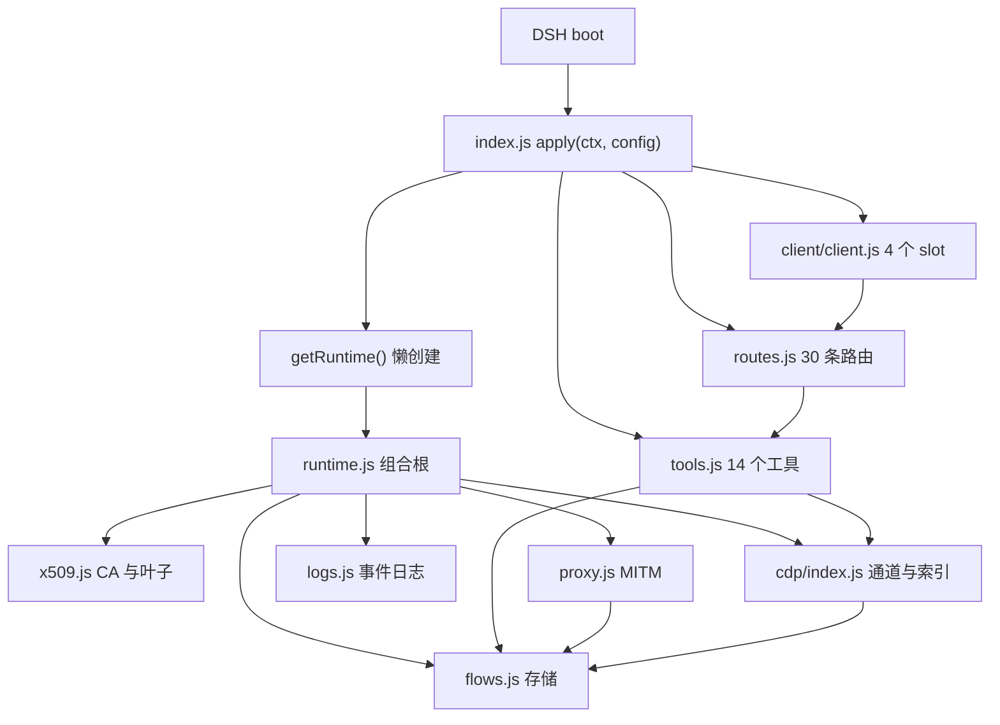
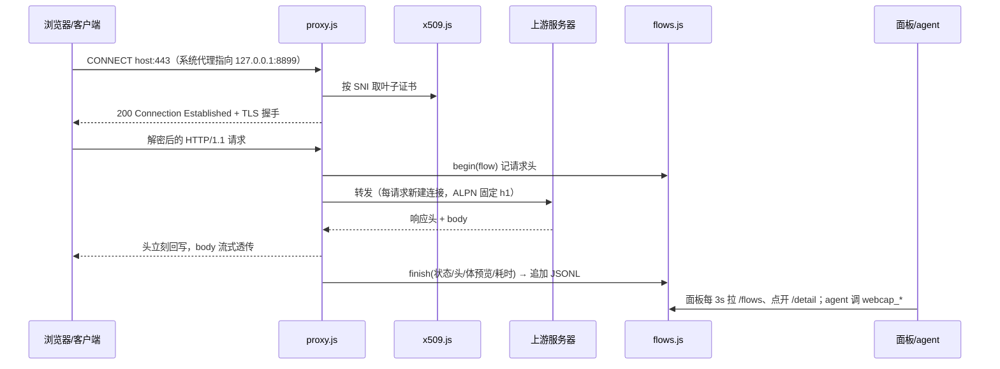

# dsh-flowspot 概览（最小视图）

只讲文件职责与数据流，不替代 `architecture.md`（目标态与不做）、`pipelines.md`（实现细节）、`adr.md`（为什么）。对应 0.6.x 的源码。

## 一句话

它是**一个进程内的 MITM 代理 + 一个面板 + 一批 agent 工具**：宿主侧（Node）负责解密、存 flow；面板侧（浏览器 bundle）只负责显示；两边通过 `/dsh-flowspot/*` 路由连起来，而路由和 agent 工具共用同一批 `tool.execute`，所以“面板看到的”和“agent 读到的”永远是同一份数据。

## 文件结构（按层看，不按字母看）

```text
dsh-flowspot/
├── index.js            插件入口：apply(ctx, config)。只做三件事——懒建 runtime、挂路由、注册工具
├── cordis.patch.yml    “这个包装进 profile 时加载哪一行”的描述
├── package.json        name / main / exports / dsh.bundle / dsh.client / engines
├── lib/                宿主侧（改动要重启 DSH）
│   ├── runtime.js      组合根：配置归一化、数据目录、CA、store、proxy、日志、status/dispose
│   ├── proxy.js        MITM 内核：CONNECT → 200 → TLS(按 SNI 发证) → 内层 HTTP/1.1 → 上游
│   ├── flows.js        flow 存储：环形缓冲、JSONL、解压/截断、分类、合并、搜索、HAR；curl 委托 codegen
│   ├── codegen/        请求模型 + 6 个语言模板 + 语言偏好
│   ├── cdp/            CDP 通道：client/launch/network/initiator/scripts/params/index
│   │                   + format（片段展开）+ sourceStore（源码落盘）+ sourceFilter（业务接口筛选）
│   ├── zip.js          零依赖 ZIP（把 extension/ 打成可下载的扩展包）
│   ├── x509.js/der.js  自写 CA / 叶子证书 / ASN.1 原语
│   ├── certstore.js    certutil 装/卸/查 Windows 信任根
│   ├── sysproxy.js/.ps1 写注册表 + InternetSetOption 广播
│   ├── sysbin.js     系统命令解析（System32 绝对路径兜底，桌面端 PATH 裁剪时用）
│   ├── tools.js        14 个 webcap_* 工具（agent 侧的唯一事实源）
│   ├── routes.js       30 条 /dsh-flowspot/*（面板侧，内部调 tool.execute）
│   ├── logs.js         事件日志（只记非请求事件）+ 读取/打开目录/在资源管理器选中文件
│   └── location.js     DSH home 下的 pointer 文件（数据目录 / 代码语言 / CDP 通道）
├── extension/          浏览器扩展（MV3，chrome.debugger 接管当前标签页）
├── client/client.js    面板侧（刷新页面即生效）：4 个 slot 注册 + 三块布局 + 两模式 + 设置弹窗 + 代码页 + 调用链 + 源码查看器
├── locale/             插件管理器里的标题与描述
├── scripts/            本机探针脚本（真实 CDP 抓包/对照），**不进仓**（见 .gitignore）
├── test/               11 个文件 / 127 条契约测试（当 API 文档看）
├── docs/               adr(为什么) / architecture(模块与不做) / pipelines(怎么做) / engineering(踩坑) / todo(方向)
└── proxypin-mcp/       独立的配置型 bundle，给手机 ProxyPin 用，不随主插件加载
```

记住一个划分就够了：**`lib/` 是宿主，`client/` 是面板，`docs/` 是设计**。宿主代码只在 DSH 进程启动时 import，所以改 `lib/` 要重启；面板 bundle 每次刷新页面重新取，所以改 `client/` 刷新即可——这也是 `status.build` 用来判断“半边新半边旧”的原因。

## 两张图

**加载关系**（谁在什么时候被装进来）：



**一次 HTTPS 请求**（主流程，读 `proxy.js` 就照这个顺序）：



几个“藏在代码里”的要点，理解了它们项目就通了：

- **CONNECT 之后的流量不是新连接**：外层 `server` 收到 CONNECT，`tls.TLSSocket` 包住原 socket，内层 `inner` 靠 TLS `'secure'` 事件挂上去，`socket.__target` 是隧道内请求找目标的唯一依据。
- **上游不复用连接**（ADR-0007）：抓包排障场景，多一次握手换“错误一定是这条请求自己的”。
- **响应不攒整包**：头立刻回写，body 用 `PassThrough` 直通，所以 SSE/长轮询不会被缓冲卡住；缓存副本只到 `maxBodyBytes`。
- **flow 落盘按会话**：`start()` 只开新会话，第一条完成的 flow 才创建 `flows-<时间戳>.jsonl`，`stop()` 关——只加载插件不会留空文件。
- **CA 在插件加载时就生成**（`createRuntime()`），不是点“开始抓包”才建。

## 抓包记录里存了什么

一次「开始抓包 → 停止抓包」= 一个抓包会话 = 一份 `flows/flows-<时间戳>.jsonl`。面板列表读的是**内存**（最近 1000 条），文件是给事后回读的；点「清空」只清内存，不删文件。

每条 flow 存：方法、URL、请求头、响应头、状态码、耗时、错误，以及**请求体/响应体的预览**。头是完整的；体只留一段：

| 位置 | 文本体 | 二进制体 |
|---|---|---|
| 捕获到内存 | 响应前 256 KiB、请求前 64 KiB（解压后） | 前 256 KiB 字节，转 base64 |
| 写入 JSONL | 文本再切到 32768 **字符** | 不切 |
| 读出来 | `webcap_body` 分页 4K–64K 字符；面板详情取前 4000 字符 | base64 分页 |

记住三件事：

- **只截体，不截头/状态/耗时**：客户端和源站拿到的是完整流，截断只影响“记录里剩多少”。
- **`truncated` 只表示超过了捕获上限**：落盘那次 32K 字符的二次切不会更新它；`respBytes` / `bytes` 是“捕获到的长度”，不是真实全长。
- **大压缩响应可能只剩半截**：上限按压缩后的字节收集，压缩体超限后解压失败，会按 mime 当文本或 base64，且不一定标 `truncated`；看到乱码先怀疑这条。

所以摘要通常够“看清接口 + 重放常见请求”（重放只需要方法、URL、头和请求体），但不够拿回完整大报文、文件或长流；`timestamp` / `sign` 这类动态参数也只是当时的值，不会被重算。

## 设计原则（为什么长这样）

| 原则 | 代码里的体现 | 为什么 |
|---|---|---|
| 一个进程一个 runtime | `getRuntime()` 懒建、失败记住错误 | 面板、agent、路由共用同一份 flow 缓冲，不能有两个实例抢 8899 |
| 零运行时依赖 | `package.json` 没有 dependencies；证书手写 DER/X.509；日志自研 ndjson | `link:` 装进 profile 时，第三方依赖解析不可靠；抓包插件最不该在证书链上踩依赖升级（ADR-0003） |
| 无构建、纯 JS + JSDoc | 没有 tsconfig/vite；类型写在注释里 | 装进 profile 只多几个文件，没有“产物与源码不同步”的失败面（ADR-0006） |
| 面板与 agent 同一份实现 | `routes.js` 里的每个 handler 都 `call('webcap_x')` → `tool.execute` | 两个读取方不可能对同一条 flow 说法不一致 |
| 宿主/面板两个生命周期 | `status.build` + 面板顶部“宿主侧旧版本”横幅；旧宿主缺 `grouped` 时走 `groupLocal()` | 刷新页面 ≠ 重启进程，协议必须能表达“对面不认识这个参数”（engineering 第 4 条） |
| 用户选择的落点分开 | 端口/上限 → `cordis.patch.yml`（改配置，重启）；数据目录 → DSH home pointer（重启生效）；代码语言 / CDP 通道 → pointer（立即生效） | 不是所有“设置”都该进 profile，改按钮顺序不该重启 DSH（ADR-0013/0016） |
| CDP 是旁路，不接管抓包 | 代理自己抓；`lib/cdp/` 只读 events 解释“谁发的、哪段代码发的”；配对按时间窗，不共享请求 id | ADR-0001 选的是自研 MITM；两套“真相”会互相污染（ADR-0017/0019） |
| 运行日志给人和 agent 共用 | 同一个 `lib/logs.js`：面板只负责打开目录、`webcap_logs` 读事件、`webcap_status` 给日志路径 | 出问题时先看「为什么」；只记非请求事件，不把报文抄进日志（ADR-0012） |
| 失败要能诊断 | `errorCode` + `errorPhase` + `errorHint`；客户端主动断开不算失败 | “socket hang up”这种消息单独看没有意义 |
| 默认不做的事写死 | `architecture.md`「明确不做 / 暂时不做」 | 防止“顺手加个 Npcap / VPN”把项目带偏 |

## 一个功能怎么接进来（拿刚做的 codegen 当例子）

新功能的标准接线方式就四步，你在别的模块也会看到同样的形状：

```text
flow ──requestSpecOf()──> RequestSpec ──render(lang)──> code
                              │
                              ├─ tools.js  webcap_code        （agent 读）
                              ├─ routes.js /code、/code-prefs （面板读）
                              └─ client.js 详情「请求 | 代码」 （人读）
```

- 逻辑放 `lib/<能力>/`，**不要**塞进 `routes.js` 或 `client.js`；
- 给 agent 和面板各开一个入口，但都指向同一段实现；
- 面板只做“取数 + 显示”，不做业务判断；
- 测试盯住契约（`test/codegen.test.mjs` 断言的是“哪种体生成什么形状”，不是“字符串完全相等”）。

## 你该从哪读（30 分钟路线）

| 顺序 | 读什么 | 读的时候找什么 |
|---|---|---|
| 1 | [package.json](../package.json) + [cordis.patch.yml](../cordis.patch.yml) + [index.js](../index.js) | “插件怎么被加载、注入了哪些宿主服务、卸载时做什么” |
| 2 | [lib/runtime.js](../lib/runtime.js) | 配置默认值、数据目录优先级、status 里暴露了什么 |
| 3 | [lib/proxy.js](../lib/proxy.js) | 只跟 `_handleConnect` → `_handleRequest` 两条线，其它先跳过 |
| 4 | [lib/flows.js](../lib/flows.js) | flow 的字段（`begin`）、`finish`、`list/listGroups`、`summaryOf` |
| 5 | [lib/tools.js](../lib/tools.js) + [lib/routes.js](../lib/routes.js) | “对外暴露了什么”，这是整个项目的 API 面 |
| 6 | [client/client.js](../client/client.js) | 先看 `Panel` 的 state 和两个 3 秒轮询，再看三块布局，最后才是末尾的 `<style>` |
| 7 | [test/](../test) | 测试就是第二份规格：每个 `test(...)` 名字就是一条行为 |
| 8 | [docs/pipelines.md](./pipelines.md) | 把 2–6 步串成“一次抓包 / 一次读取”的文字版 |

纯 JS 项目“把握不住”的解法，其实项目已经铺好了：

- **看文件头**：每个文件顶部的注释写的是契约（这个模块负责什么、不负责什么），比函数名信息量大；
- **看 JSDoc**：`@param` / `@returns` 就是类型，VS Code 里能悬停、能跳转；想再强一点，可以加一个 `jsconfig.json`（`checkJs: true`）让编辑器做检查，代码一行不用改（ADR-0006 里就是这么规划的）；
- **看 import**：ESM 的 import 就是依赖图，`lib/` 内部没有环，`client/` 不 import `lib/`（只走 HTTP 路由）；
- **看测试**：127 条契约测试按文件分就是 11 个能力域。

## 规划（这份项目现在的阶段）

- **阶段 1–3**（已完成）：能装 → 能抓一条 → 面板/筛选/合并/导出/时间窗。
- **阶段 4**（暂时不做）：h2、WS 帧解析、规则改写、macOS/Linux。
- **阶段 5**（0.3.0，已完成）：请求详情「请求 / 代码」两页 + 6 语言 + 语言偏好。
- **阶段 6A**（0.4.0 试过，已撤下）：受控独立 profile 实测不采用（空白新页、登录态不共享）；相关代码只作手动 attach 的遗留路径。
- **阶段 6B/6D**（已完成）：扩展桥接管当前浏览器（`chrome.debugger`）→ 标签页列表/选择/重选 → 两互斥模式 → 调用链（同步段 + `stack.parent` 异步段展平）→ 源码按调用链落盘、查看器只读本地（`{}` 式展开 + 同名翻页 + 打开文件夹）→ 详情与系统抓包统一成「请求 / 代码」两页。
- **阶段 6B2**（未做）：断点读作用域定位参数来源；进程级来源识别也待做（`docs/todo.md`）。
- 另外三个“不做”的边界：手机抓包、VPN/驱动/Npcap 嗅探、证书 pinning 绕过。
